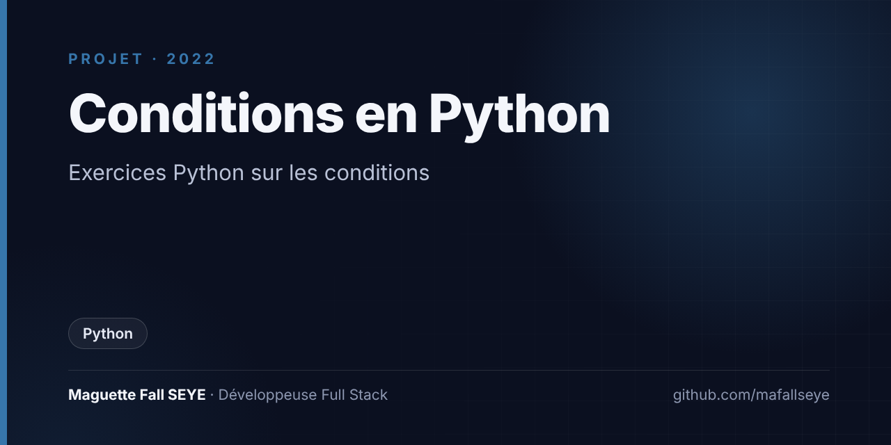

<p align="center"></p>

# Conditions en Python

Exercices Python sur les conditions.

## Fonctionnalités

- Structures `if` / `elif` / `else`

## Technologies

Python

## Lancer le projet

Prérequis : Python 3.

```bash
git clone https://github.com/mafallseye/condition_in_pithon.git
cd condition_in_pithon
python <fichier>.py
```

> Projet réalisé en 2022 pendant ma formation. Il est conservé ici comme trace de mon parcours.

## Auteure

**Maguette Fall SEYE** — Développeuse Full Stack, Dakar (Sénégal) · [github.com/mafallseye](https://github.com/mafallseye)
